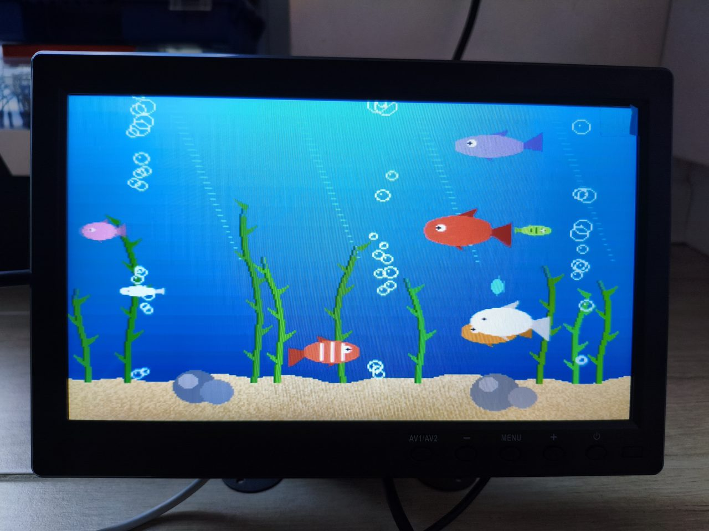

# Pico2HdmiHwTest – akwarium na HDMI



Program testowy sprawdzający porawność działania sprzętu (celem nie było osiągnięcie
idalnej animacji tylko sprawdzenie czy powstaje obraz i jest odczytywany przez monitor)

Animowane akwarium wyświetlane na monitorze HDMI przez Adafruit Feather RP2350. Na ekranie widać gradient wody z promieniami światła, piasek, kamienie, falujące rośliny, bąbelki i 9 ryb o losowych kolorach i rozmiarach. Ryby płyną do losowych celów i płynnie zawracają przy ścianach.

Obraz ma rozdzielczość 320x240 w kolorze 16-bit (RGB565), jest podwójnie buforowany i wysyłany na HDMI jako 640x480 @ 60 Hz.

## Sprzęt

- Adafruit Feather RP2350 (wersja z 8 MB PSRAM)
- Adafruit DVI Sock / adapter DVI dla złącza HSTX
- Taśma FFC łącząca złącze HSTX Feathera z adapterem
- Kabel HDMI i monitor

## Oprogramowanie

- PlatformIO z platformą `maxgerhardt/platform-raspberrypi` (rdzeń Arduino-Pico, earlephilhower)
- Płytka: `adafruit_feather_rp2350_hstx`
- Biblioteki (pobierane automatycznie): Adafruit GFX Library, Adafruit DVI HSTX

## Kompilacja i wgrywanie

```bash
pio run                # kompilacja
pio run -t upload      # wgranie na płytkę
```

Przy pierwszym wgraniu wejdź w tryb bootloadera: przytrzymaj **BOOT**, naciśnij i puść **RESET**, potem puść **BOOT**. Pojawi się dysk RP2350. Możesz też skopiować na niego plik `.pio/build/feather_rp2350/firmware.uf2`.

## Monitor portu szeregowego

```bash
pio device monitor     # 115200 baud
```

Co 5 sekund program wypisuje liczbę klatek na sekundę (`FPS: ...`).

Jeśli dioda na płytce szybko miga, nie udało się uruchomić obrazu (np. zabrakło pamięci na bufory).

## Uwagi o monitorze

Sygnał 640x480 ma proporcje 4:3. Na monitorach o innych proporcjach (np. 1024x600) obraz może mieć czarne pasy po bokach albo być rozciągnięty. Użyj ustawienia proporcji lub powiększenia (Aspect / Zoom) w menu monitora.
